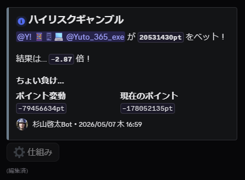

<h1>
  多機能ゲームBot (杉山啓太Bot)
  
  
  
  
  
</h1>
会話要約、画像生成・加工、そしてオセロや四目並べといったゲーム機能など 
詰めるだけ詰め込んだだけのBot!!! 
 

 
このBotのギャンブルに沼った人.png

 

## なんのためにつくった...?

クソ暇だった2025年GW。  
暇なので自分が思いつく限り面白そーなコマンドやゲーム機能を入れたBotをPython1枚3000行で作成ww  
一応分割して今に至ります。全然管理はできてないので今でも自分では意味わからん構成してる助けて。  

**2025/06/14 やまかわてるき鯖へのBeta版導入。** 今でも使われてる。そして今でもBeta版。(現在2026/06/21)  
**2026/10 TypeScript + discord.js に全面書き直し。全部の応答がComponents v2のカードになった。**  

## 軽い説明

会話要約、画像生成・加工、そしてオセロや四目並べといったゲーム機能を提供します。  
色々コマンドはあるのでリスト参考にしてもらって遊んでみてください。  
**コマンドの実行は、許可されたチャンネル内でコマンド名と引数を入力するだけで行えます！！**  

詳しい使い方・設定・運用方法は [ドキュメント一覧](docs/README.md) を参照してください。

## できること

| カテゴリ | 主な機能 | 詳しい使い方 |
| --- | --- | --- |
| ゲーム | オセロ・四目並べ・チェス・マインスイーパー・じゃんけん・ハイロー | [ゲーム](docs/guide/games.md) |
| ポイント | ログインボーナス・ランキング・送金・Bet・ギャンブル | [ポイント](docs/guide/points.md) |
| 画像・音声 | 文字画像・スタンプ・画像加工・読み上げ・ボイチェン | [画像・音声](docs/guide/media.md) |
| 便利機能 | 会話要約・天気・為替・世界時計・プロフィール | [便利機能](docs/guide/utility.md) |

## 導入・開発

Bun **1.3.14以上** を使います。ローカルはPGlite、本番はPostgreSQLです。

| やりたいこと | ドキュメント |
| --- | --- |
| 自分の環境で起動する | [セットアップ](docs/operations/setup.md) |
| Docker・バックアップ・エラーを確認する | [運用・エラー調査](docs/operations/maintenance.md) |
| コードを変更・テストする | [開発・テスト](docs/development/testing.md) |

## バグ報告

エラー画面・エラーログの **「バグを報告」**、または [報告フォーム](https://github.com/y-exe/games-bot/issues/new?template=bug-report.yml) から送れます。
個人情報や非公開の会話は載せず、セキュリティに関する問題は [専用の連絡先](SECURITY.md) へお願いします。

## クレジット・使用API

*   **DeepSeek API:** チャット要約、地名推測など
*   **VoiceVox (Web API):** テキスト読み上げ
*   **RVC:** やまかわボイチェン（音声変換）
*   **つくもAPI:** 天気予報データ
*   **Exchange Rate API:** 為替レート
*   **5000兆円欲しい！API** 

## ライセンス

[GPL-3.0](LICENSE)  
改変した後、ネットワーク経由でユーザーにサービスを提供する場合、ソースコードの公開義務が発生します。

---

© 2026 yexe
